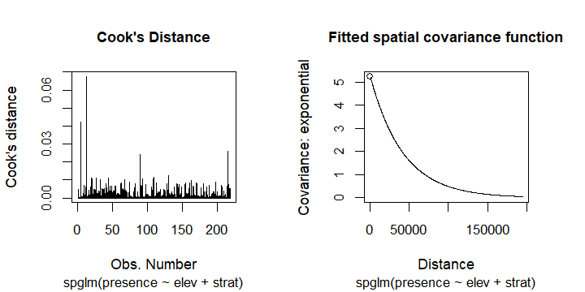
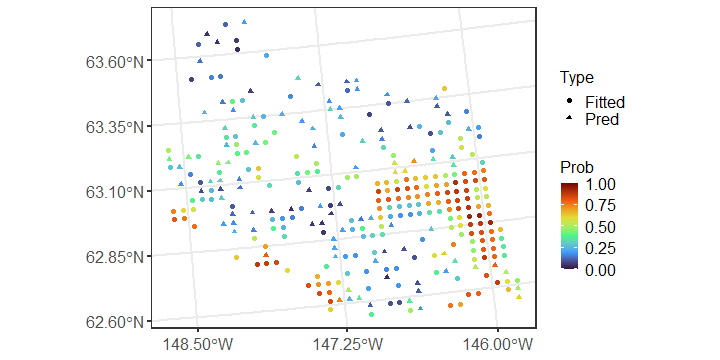
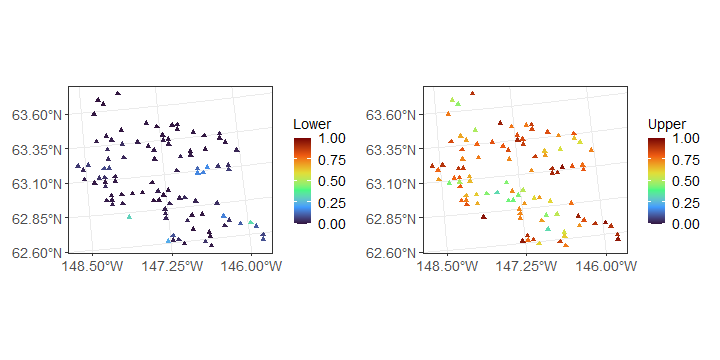
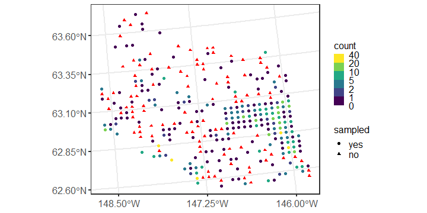
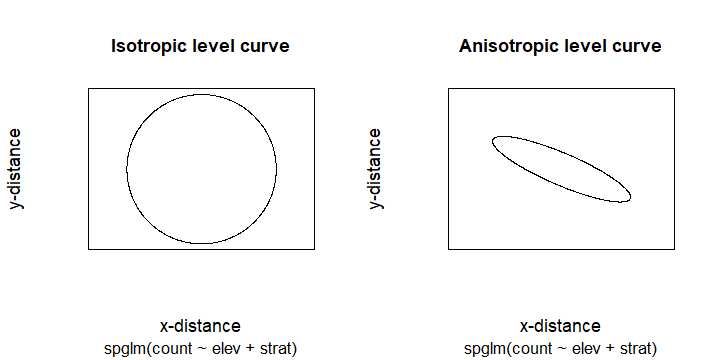
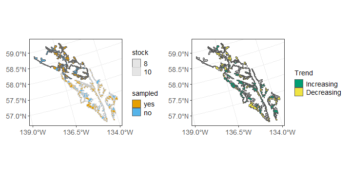
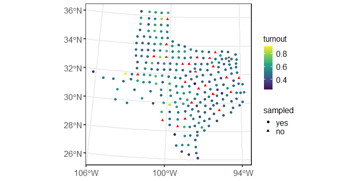

``` r
#=========================================================#
# Section 3: Modeling moose presence in Alaska, USA ####
#=========================================================#

library("spmodel")

head(moose)
```

```
## Simple feature collection with 6 features and 4 fields
## Geometry type: POINT
## Dimension:     XY
## Bounding box:  xmin: 281896.4 ymin: 1518398 xmax: 311325.3 ymax: 1541016
## Projected CRS: NAD83 / Alaska Albers
## # A tibble: 6 × 5
##    elev strat count presence           geometry
##   <dbl> <chr> <dbl> <fct>           <POINT [m]>
## 1  469. L         0 0        (293542.6 1541016)
## 2  362. L         0 0        (298313.1 1533972)
## 3  173. M         0 0        (281896.4 1532516)
## 4  280. L         0 0        (298651.3 1530264)
## 5  620. L         0 0        (311325.3 1527705)
## 6  164. M         0 0        (291421.5 1518398)
```

``` r
head(moose_preds)
```

```
## Simple feature collection with 6 features and 2 fields
## Geometry type: POINT
## Dimension:     XY
## Bounding box:  xmin: 291839.8 ymin: 1436192 xmax: 401239.6 ymax: 1512103
## Projected CRS: NAD83 / Alaska Albers
## # A tibble: 6 × 3
##    elev strat           geometry
##   <dbl> <chr>        <POINT [m]>
## 1  143. L     (401239.6 1436192)
## 2  324. L     (352640.6 1490695)
## 3  158. L     (360954.9 1491590)
## 4  221. M     (291839.8 1466091)
## 5  209. M     (310991.9 1441630)
## 6  218. L     (304473.8 1512103)
```

``` r
#==========================================#
# Section 3.1: Model Fitting ####
#==========================================#

spbin <- spglm(
  formula = presence ~ elev + strat,
  family = binomial,
  data = moose,
  spcov_type = "exponential"
)

summary(spbin)
```

```
## 
## Call:
## spglm(formula = presence ~ elev + strat, family = binomial, data = moose, 
##     spcov_type = "exponential")
## 
## Deviance Residuals:
##     Min      1Q  Median      3Q     Max 
## -1.7537 -0.7985  0.3467  0.7873  1.5767 
## 
## Coefficients (fixed):
##              Estimate Std. Error z value Pr(>|z|)    
## (Intercept) -2.474023   1.498874  -1.651 0.098823 .  
## elev         0.006062   0.003540   1.712 0.086862 .  
## stratM       1.441894   0.421669   3.419 0.000627 ***
## ---
## Signif. codes:  0 '***' 0.001 '**' 0.01 '*' 0.05 '.' 0.1 ' ' 1
## 
## Pseudo R-squared: 0.06276
## 
## Coefficients (exponential spatial covariance):
##        de        ie     range 
## 5.244e+00 5.244e-04 4.214e+04 
## 
## Coefficients (Dispersion for binomial family):
## dispersion 
##          1
```

``` r
tidy(spbin, conf.int = TRUE)
```

```
## # A tibble: 3 × 7
##   term        estimate std.error statistic  p.value conf.low conf.high
##   <chr>          <dbl>     <dbl>     <dbl>    <dbl>    <dbl>     <dbl>
## 1 (Intercept) -2.47      1.50        -1.65 0.0988   -5.41e+0    0.464 
## 2 elev         0.00606   0.00354      1.71 0.0869   -8.77e-4    0.0130
## 3 stratM       1.44      0.422        3.42 0.000627  6.15e-1    2.27
```

``` r
#==========================================#
# Section 3.2: Model Comparison ####
#==========================================#

bin <- spglm(
  formula = presence ~ elev + strat,
  family = binomial,
  data = moose,
  spcov_type = "none"
)
glance(spbin)
```

```
## # A tibble: 1 × 10
##       n     p  npar value   AIC  AICc   BIC logLik deviance
##   <int> <dbl> <int> <dbl> <dbl> <dbl> <dbl>  <dbl>    <dbl>
## 1   218     3     3  276.  282.  282.  292.  -138.     175.
## # ℹ 1 more variable: pseudo.r.squared <dbl>
```

``` r
glance(bin)
```

```
## # A tibble: 1 × 10
##       n     p  npar value   AIC  AICc   BIC logLik deviance
##   <int> <dbl> <int> <dbl> <dbl> <dbl> <dbl>  <dbl>    <dbl>
## 1   218     3     0  307.  307.  307.  307.  -154.     294.
## # ℹ 1 more variable: pseudo.r.squared <dbl>
```

``` r
bin_ml <- update(bin, estmethod = "ml")
bin_glm <- glm(
  formula = presence ~ elev + strat,
  family = binomial,
  data = moose
)
logLik(bin_ml)
```

```
## 'log Lik.' -146.8733 (df=3)
```

``` r
logLik(bin_glm)
```

```
## 'log Lik.' -146.8733 (df=3)
```

``` r
loocv(spbin)
```

```
## # A tibble: 1 × 3
##        bias  MSPE RMSPE
##       <dbl> <dbl> <dbl>
## 1 0.0000406 0.155 0.394
```

``` r
loocv(bin)
```

```
## # A tibble: 1 × 3
##       bias  MSPE RMSPE
##      <dbl> <dbl> <dbl>
## 1 -1.23e-9 0.240 0.490
```

``` r
spbin2 <- update(spbin, spcov_type = "gaussian")
glances(spbin, spbin2)[, c("model", "AIC", "AICc", "BIC")]
```

```
## # A tibble: 2 × 4
##   model    AIC  AICc   BIC
##   <chr>  <dbl> <dbl> <dbl>
## 1 spbin2  279.  279.  289.
## 2 spbin   282.  282.  292.
```

``` r
#==========================================#
# Section 3.3: Model Diagnostics ####
#==========================================#

augment(spbin)
```

```
## Simple feature collection with 218 features and 8 fields
## Geometry type: POINT
## Dimension:     XY
## Bounding box:  xmin: 269085 ymin: 1416151 xmax: 419057.4 ymax: 1541016
## Projected CRS: NAD83 / Alaska Albers
## # A tibble: 218 × 9
##    presence  elev strat .fitted .resid    .hat  .cooksd .std.resid
##  * <fct>    <dbl> <chr>   <dbl>  <dbl>   <dbl>    <dbl>      <dbl>
##  1 0         469. L       -1.96 -0.513 0.0473  0.00457      -0.525
##  2 0         362. L       -2.71 -0.358 0.0122  0.000535     -0.360
##  3 0         173. M       -1.97 -0.511 0.00451 0.000397     -0.512
##  4 0         280. L       -3.16 -0.288 0.00408 0.000114     -0.289
##  5 0         620. L       -1.20 -0.725 0.167   0.0422       -0.794
##  6 0         164. M       -1.72 -0.574 0.00532 0.000591     -0.576
##  7 0         164. M       -1.61 -0.604 0.00574 0.000707     -0.606
##  8 0         186. L       -2.51 -0.396 0.00438 0.000230     -0.396
##  9 0         362. L       -1.89 -0.529 0.0238  0.00233      -0.536
## 10 0         430. L       -1.55 -0.621 0.0497  0.00706      -0.637
## # ℹ 208 more rows
## # ℹ 1 more variable: geometry <POINT [m]>
```

``` r
varcomp(spbin)
```

```
## # A tibble: 3 × 2
##   varcomp            proportion
##   <chr>                   <dbl>
## 1 Covariates (PR-sq)  0.0628   
## 2 de                  0.937    
## 3 ie                  0.0000937
```

``` r
#==========================================#
# Section 3.4: Prediction ####
#==========================================#

predict(spbin, newdata = moose_preds)[1:5]
```

```
##           1           2           3           4           5 
##  0.06989524 -0.79411725 -1.61106131 -0.83935088  1.39081663
```

``` r
predict(spbin, newdata = moose_preds, type = "response")[1:5]
```

```
##         1         2         3         4         5 
## 0.5174667 0.3112853 0.1664413 0.3016715 0.8007226
```

``` r
predict(spbin, newdata = moose_preds, interval = "prediction")[1:5, ]
```

```
##           fit        lwr       upr
## 1  0.06989524 -2.0456011 2.1853915
## 2 -0.79411725 -3.4952212 1.9069867
## 3 -1.61106131 -4.1166330 0.8945103
## 4 -0.83935088 -3.0915348 1.4128330
## 5  1.39081663 -0.7720673 3.5537005
```

``` r
augment(spbin, newdata = moose_preds, interval = "prediction")
```

```
## Simple feature collection with 100 features and 5 fields
## Geometry type: POINT
## Dimension:     XY
## Bounding box:  xmin: 269386.2 ymin: 1418453 xmax: 419976.2 ymax: 1541763
## Projected CRS: NAD83 / Alaska Albers
## # A tibble: 100 × 6
##     elev strat .fitted .lower  .upper           geometry
##  * <dbl> <chr>   <dbl>  <dbl>   <dbl>        <POINT [m]>
##  1  143. L      0.0699 -2.05   2.19   (401239.6 1436192)
##  2  324. L     -0.794  -3.50   1.91   (352640.6 1490695)
##  3  158. L     -1.61   -4.12   0.895  (360954.9 1491590)
##  4  221. M     -0.839  -3.09   1.41   (291839.8 1466091)
##  5  209. M      1.39   -0.772  3.55   (310991.9 1441630)
##  6  218. L     -2.60   -5.22   0.0234 (304473.8 1512103)
##  7  127. L     -2.74   -5.26  -0.216  (339011.1 1459318)
##  8  122. L     -2.33   -4.77   0.0978 (342827.3 1463452)
##  9  191  L     -1.17   -4.02   1.68   (284453.8 1502837)
## 10  105. L     -0.907  -3.06   1.25   (391343.9 1483791)
## # ℹ 90 more rows
```

``` r
#=========================================================#
# Section 4: Additional Applications ####
#=========================================================#

#==========================================#
# Section 4.1: Modeling moose counts in Alaska, USA ####
#==========================================#

sppois <- spglm(
  formula = count ~ elev + strat,
  family = poisson,
  data = moose,
  spcov_type = "spherical"
)
spnb <- update(sppois, family = nbinomial)

BIC(sppois, spnb)
```

```
##        df      BIC
## sppois  3 943.7197
## spnb    4 941.8881
```

``` r
sppois_anis <- update(sppois, anisotropy = TRUE)
spnb_anis <- update(spnb, anisotropy = TRUE)

BIC(sppois, spnb, sppois_anis, spnb_anis)
```

```
##             df      BIC
## sppois       3 943.7197
## spnb         4 941.8881
## sppois_anis  5 940.4199
## spnb_anis    6 938.9993
```

``` r
#==========================================#
# Section 4.2: Modeling lake conductivity in Southwest, USA ####
#==========================================#

spgam <- spglm(
  formula = cond ~ temp * state + origin,
  family = "Gamma",
  data = lake,
  spcov_type = "cauchy",
  partition_factor = ~ year
)

summary(spgam)
```

```
## 
## Call:
## spglm(formula = cond ~ temp * state + origin, family = "Gamma", 
##     data = lake, spcov_type = "cauchy", partition_factor = ~year)
## 
## Deviance Residuals:
##      Min       1Q   Median       3Q      Max 
## -1.25870 -0.18421 -0.03273  0.16951  1.00464 
## 
## Coefficients (fixed):
##               Estimate Std. Error z value Pr(>|z|)    
## (Intercept)    3.56516    0.50509   7.058 1.68e-12 ***
## temp           0.15281    0.03015   5.068 4.02e-07 ***
## stateCO       -0.01340    0.56220  -0.024  0.98098    
## stateNV        0.77487    0.66791   1.160  0.24600    
## stateUT       -0.17698    0.55945  -0.316  0.75174    
## originNATURAL  0.08565    0.22142   0.387  0.69890    
## temp:stateCO   0.13488    0.04817   2.800  0.00511 ** 
## temp:stateNV   0.01781    0.05808   0.307  0.75911    
## temp:stateUT   0.19723    0.04833   4.081 4.49e-05 ***
## ---
## Signif. codes:  0 '***' 0.001 '**' 0.01 '*' 0.05 '.' 0.1 ' ' 1
## 
## Pseudo R-squared: 0.7093
## 
## Coefficients (cauchy spatial covariance):
##        de        ie     range     extra 
## 2.722e-02 3.218e-01 6.062e+06 2.663e-01 
## 
## Coefficients (Dispersion for Gamma family):
## dispersion 
##      4.095
```

``` r
anova(spgam)
```

```
## Analysis of Variance Table
## 
## Response: cond
##             Df    Chi2 Pr(>Chi2)    
## (Intercept)  1 49.8221 1.683e-12 ***
## temp         1 25.6843 4.021e-07 ***
## state        3  3.0926 0.3775687    
## origin       1  0.1496 0.6989043    
## temp:state   3 19.3168 0.0002351 ***
## ---
## Signif. codes:  0 '***' 0.001 '**' 0.01 '*' 0.05 '.' 0.1 ' ' 1
```

``` r
pairs(emmeans::emmeans(spgam, ~ state | temp))
```

```
## temp = 7.63:
##  contrast estimate    SE  df z.ratio p.value
##  AZ - CO    -1.016 0.337 Inf  -3.015  0.0137
##  AZ - NV    -0.911 0.348 Inf  -2.614  0.0443
##  AZ - UT    -1.329 0.327 Inf  -4.068  0.0003
##  CO - NV     0.106 0.258 Inf   0.410  0.9768
##  CO - UT    -0.312 0.224 Inf  -1.395  0.5022
##  NV - UT    -0.418 0.245 Inf  -1.705  0.3210
## 
## Results are averaged over the levels of: origin 
## Degrees-of-freedom method: asymptotic 
## Results are given on the log (not the response) scale. 
## P value adjustment: tukey method for comparing a family of 4 estimates
```

``` r
emmeans::emtrends(spgam, ~ state, var = "temp")
```

```
##  state temp.trend     SE  df asymp.LCL asymp.UCL
##  AZ         0.153 0.0302 Inf    0.0937     0.212
##  CO         0.288 0.0370 Inf    0.2151     0.360
##  NV         0.171 0.0502 Inf    0.0722     0.269
##  UT         0.350 0.0369 Inf    0.2777     0.422
## 
## Results are averaged over the levels of: origin 
## Degrees-of-freedom method: asymptotic 
## Confidence level used: 0.95
```

``` r
#==========================================#
# Section 4.3: Modeling harbor seal trends in Alaska, USA ####
#==========================================#

seal$is_decreasing <- seal$trend < 1
spbin_seal <- spgautor(
  formula = is_decreasing ~ 1,
  family = binomial,
  data = seal,
  spcov_type = "car",
  random = ~ stock
)

tidy(spbin_seal, conf.int = TRUE)
```

```
## # A tibble: 1 × 7
##   term        estimate std.error statistic p.value conf.low conf.high
##   <chr>          <dbl>     <dbl>     <dbl>   <dbl>    <dbl>     <dbl>
## 1 (Intercept)    0.335     0.626     0.534   0.593   -0.893      1.56
```

``` r
emmeans::emmeans(spbin_seal, ~ 1, type = "response")
```

```
##  1        prob    SE  df asymp.LCL asymp.UCL
##  overall 0.583 0.152 Inf     0.291     0.827
## 
## Degrees-of-freedom method: asymptotic 
## Confidence level used: 0.95 
## Intervals are back-transformed from the logit scale
```

``` r
predict(spbin_seal, type = "response", interval = "prediction")[1:5, ]
```

```
##          fit       lwr       upr
## 1  0.6790592 0.3810180 0.8791211
## 9  0.5859764 0.2358680 0.8664793
## 13 0.6136317 0.2888352 0.8613150
## 15 0.5976789 0.2831359 0.8482017
## 18 0.6334075 0.3281146 0.8594164
```

``` r
#==========================================#
# Section 4.4: Modeling voter turnout in Texas, USA ####
#==========================================#

spbeta_geo <- spglm(
  formula = turnout ~ log_income,
  family = "beta",
  data = texas,
  spcov_type = "matern"
)

spbeta_auto <- spgautor(
  formula = turnout ~ log_income,
  family = "beta",
  data = texas,
  spcov_type = "car",
  cutoff = 1e5
)

AIC(spbeta_geo, spbeta_auto)
```

```
##             df       AIC
## spbeta_geo   5 -465.8884
## spbeta_auto  3 -443.4700
```

``` r
spbeta_full_ml <- update(spbeta_geo, estmethod = "ml")
spbeta_reduced_ml <- update(spbeta_full_ml, formula = turnout ~ 1)
anova(spbeta_full_ml, spbeta_reduced_ml)
```

```
## Likelihood Ratio Test
## 
## Response: turnout
##                                     Df  Chi2 Pr(>Chi2)    
## spbeta_reduced_ml vs spbeta_full_ml  1 19.17 1.196e-05 ***
## ---
## Signif. codes:  0 '***' 0.001 '**' 0.01 '*' 0.05 '.' 0.1 ' ' 1
```

``` r
#=========================================================#
# Figures ####
#=========================================================#

library("ggplot2", verbose = FALSE)
library("dplyr", verbose = FALSE)
library("patchwork")
theme_caption_sized <- function(size = 14) {
  theme_bw(base_size = size) +
    theme(
      axis.text = element_text(size = size),
      axis.title = element_text(size = size),
      legend.text = element_text(size = size),
      legend.title = element_text(size = size),
      plot.tag = element_text(size = size)
    )
}

#==========================================#
# Figure 1 ####
#==========================================#
h <- seq(0, 1, length.out = 1000)
range1 <- 0.2
dat1 <- data.frame(Distance = h, Correlation = exp(-h/range1), Range = "0.2")
range2 <- 0.5
dat2 <- data.frame(Distance = h, Correlation = exp(-h/range2), Range = "0.5")
range3 <- 0.8
dat3 <- data.frame(Distance = h, Correlation = exp(-h/range3), Range = "0.8")
dat <- bind_rows(dat1, dat2, dat3)
dat$Range <- factor(dat$Range, levels = c("0.8", "0.5", "0.2"))
cor_range <- ggplot(dat, aes(x = Distance, y = Correlation, color = Range, linetype = Range)) +
  geom_line(linewidth = 1.2) +
  scale_color_viridis_d() +
  theme_caption_sized(13)

h <- seq(0, 1, length.out = 1000)
range <- 0.5
dat1 <- data.frame(Distance = h, Correlation = exp(-h/range), Type = "Exponential")
dat2 <- data.frame(Distance = h, Correlation = exp(-(h/range)^2), Type = "Gaussian")
dat3 <- data.frame(Distance = h, Correlation = (1 - 1.5 * h/range + 0.5 * (h/range)^3) * (h <= range), Type = "Spherical")
dat <- bind_rows(dat1, dat2, dat3)
cor_type <- ggplot(dat, aes(x = Distance, y = Correlation, color = Type, linetype = Type)) +
  geom_line(linewidth = 1.2) +
  scale_color_viridis_d() +
  labs(color = "Function", linetype = "Function") +
  theme_caption_sized(13)
correlations <- cor_range | cor_type
correlations
```


``` r
#==========================================#
# Figure 2 ####
#==========================================#

okabe <- c("#E69F00", "#56B4E9", "#009E73", "#F0E442", "#0072B2", "#D55E00", "#CC79A7")
moose_comb <- bind_rows(moose |> mutate(samp = "yes"), moose_preds |> mutate(samp = "no"))
obs_pred_presence <- ggplot(moose_comb, aes(color = presence, shape = samp)) +
  geom_sf(size = 2) +
  scale_color_manual(name = "moose", values = okabe[1:2], breaks = c(1, 0), labels = c("yes", "no")) +
  scale_shape_manual(name = "sampled", values = c(19, 17), breaks = c("yes", "no"), labels = c("yes", "no")) +
  theme_caption_sized(15) +
  scale_y_continuous(breaks = seq(62.6, 63.6, length.out = 5)) +
  scale_x_continuous(breaks = seq(-148.5, -146, length.out = 3)) +
  guides(
    color = guide_legend(order = 1),
    shape = guide_legend(order = 2)
  ) +
  geom_sf(size = 2, data = moose_comb %>% filter(samp == "no"), color = "red", shape = 17)
obs_pred_presence
```


``` r
#==========================================#
# Figure 3 ####
#==========================================#

spbin_aug <- augment(spbin)

p1 <- ggplot(spbin_aug, aes(color = .hat)) +
  geom_sf(size = 1) +
  scale_color_viridis_c(option = "E", name = ".hat") +
  scale_y_continuous(breaks = seq(62.6, 63.6, length.out = 5)) +
  scale_x_continuous(breaks = seq(-148.5, -146, length.out = 3)) +
  theme_caption_sized(14)

p2 <- ggplot(spbin_aug, aes(color = .std.resid)) +
  geom_sf(size = 1) +
  scale_color_viridis_c(option = "A", limits = c(-2, 2)) +
  scale_y_continuous(breaks = seq(62.6, 63.6, length.out = 5)) +
  scale_x_continuous(breaks = seq(-148.5, -146, length.out = 3)) +
  theme_caption_sized(14)

p1 + p2
```


``` r
#==========================================#
# Figure 4 ####
#==========================================#
```

``` r
old_par <- par(no.readonly = TRUE)
par(mfrow = c(1, 2), mar = c(5.1, 4.1, 4.1, 3.2))
par(cex = 1.5, cex.main = 1, cex.axis = 0.95, cex.sub = 0.95)
plot(spbin, which = c(4, 7))
```



``` r
par(old_par)

#==========================================#
# Figure 5 ####
#==========================================#

preds_aug <- augment(
  spbin,
  newdata = moose_preds,
  type.predict = "response",
  interval = "prediction"
)
spbin_aug <- augment(spbin, type.predict = "response")
comb_aug <- bind_rows(spbin_aug %>% mutate(Type = "Fitted"), preds_aug %>% mutate(Type = "Pred"))

obs_pred_fitted <- ggplot(comb_aug, aes(color = .fitted, shape = Type)) +
  geom_sf(size = 2) +
  scale_color_viridis_c(option = "H", name = "Prob", limits = c(0, 1)) +
  scale_y_continuous(breaks = seq(62.6, 63.6, length.out = 5)) +
  scale_x_continuous(breaks = seq(-148.5, -146, length.out = 3)) +
  theme_caption_sized(16)
obs_pred_fitted
```



``` r
#==========================================#
# Figure 6 ####
#==========================================#

p1 <- ggplot(preds_aug, aes(color = .lower)) +
  geom_sf(pch = 17) +
  scale_color_viridis_c(option = "H", name = "Lower", limits = c(0, 1)) +
  scale_y_continuous(breaks = seq(62.6, 63.6, length.out = 5)) +
  scale_x_continuous(breaks = seq(-148.5, -146, length.out = 3)) +
  theme_caption_sized(14)

p2 <- ggplot(preds_aug, aes(color = .upper)) +
  geom_sf(pch = 17) +
  scale_color_viridis_c(option = "H", name = "Upper", limits = c(0, 1)) +
  scale_y_continuous(breaks = seq(62.6, 63.6, length.out = 5)) +
  scale_x_continuous(breaks = seq(-148.5, -146, length.out = 3)) +
  theme_caption_sized(14)

p1 + p2
```



``` r
#==========================================#
# Figure 7 ####
#==========================================#

obs_pred_count <- ggplot(moose_comb, aes(color = count, shape = samp)) +
  geom_sf(size = 2) +
  scale_color_binned(breaks = c(0, 1, 2, 5, 10, 20, 40), type = "viridis") +
  scale_shape_manual(name = "sampled", values = c(19, 17), breaks = c("yes", "no"), labels = c("yes", "no")) +
  theme_caption_sized(16) +
  scale_y_continuous(breaks = seq(62.6, 63.6, length.out = 5)) +
  scale_x_continuous(breaks = seq(-148.5, -146, length.out = 3)) +
  geom_sf(size = 2, data = moose_comb %>% filter(samp == "no"), color = "red", shape = 17)
obs_pred_count
```



``` r
#==========================================#
# Figure 8 ####
#==========================================#
```

``` r
old_par <- par(no.readonly = TRUE)
par(mfrow = c(1, 2))
par(cex = 1.5, cex.main = 1, cex.axis = 0.95, cex.sub = 0.95)
plot(spnb, which = 8)
plot(spnb_anis, which = 8)
```



``` r
par(old_par)

#==========================================#
# Figure 9 ####
#==========================================#
seal$sampled <- factor(if_else(is.na(seal$trend), "no", "yes"), levels = c("yes", "no"))
seal$trend_category <- factor(
  case_when(
    seal$trend > 1 ~ "Increasing",
    seal$trend < 1 ~ "Decreasing"
  ),
  levels = c("Increasing", "Decreasing")
)
p1 <- ggplot(seal, aes(fill = sampled, color = stock)) +
  geom_sf(size = 0.25) +
  theme_caption_sized(14) +
  scale_fill_manual(name = "sampled", values = okabe[1:2], breaks = c("yes", "no"), labels = c("yes", "no")) +
  scale_color_manual(name = "stock", values = c("grey40", "grey80"), breaks = c(8, 10), labels = c(8, 10)) +
  scale_y_continuous(breaks = seq(57, 59, length.out = 5)) +
  scale_x_continuous(breaks = seq(-139, -134, length.out = 3))

p2 <- ggplot(seal, aes(fill = trend_category)) +
  geom_sf(size = 0.25) +
  theme_caption_sized(14) +
  scale_fill_manual(name = "Trend", values = c("Increasing" = okabe[3], "Decreasing" = okabe[4]), breaks = c("Increasing", "Decreasing"), na.value = "grey75") +
  scale_y_continuous(breaks = seq(57, 59, length.out = 5)) +
  scale_x_continuous(breaks = seq(-139, -134, length.out = 3))

p1 + p2
```



``` r
#==========================================#
# Figure 10 ####
#==========================================#

texas$samp <- factor(if_else(is.na(texas$turnout), "no", "yes"), levels = c("yes", "no"))
obs_prop2 <- ggplot(texas, aes(color = turnout, shape = samp)) +
  geom_sf(size = 2) +
  scale_color_viridis_c(option = "D") +
  scale_shape_manual(name = "sampled", values = c(19, 17), breaks = c("yes", "no"), labels = c("yes", "no")) +
  theme_caption_sized(16) +
  scale_x_continuous(breaks = seq(-94, -106, length.out = 3)) +
  geom_sf(size = 2, data = texas %>% filter(samp == "no"), color = "red", shape = 17)
obs_prop2
```



``` r
#=========================================================#
# Session Information ####
#=========================================================#

sessionInfo()
```

```
## R version 4.4.1 (2024-06-14 ucrt)
## Platform: x86_64-w64-mingw32/x64
## Running under: Windows 11 x64 (build 26200)
## 
## Matrix products: default
## 
## 
## locale:
## [1] LC_COLLATE=English_United States.utf8 
## [2] LC_CTYPE=English_United States.utf8   
## [3] LC_MONETARY=English_United States.utf8
## [4] LC_NUMERIC=C                          
## [5] LC_TIME=English_United States.utf8    
## 
## time zone: America/Los_Angeles
## tzcode source: internal
## 
## attached base packages:
## [1] stats     graphics  grDevices utils     datasets  methods  
## [7] base     
## 
## other attached packages:
## [1] here_1.0.2      patchwork_1.3.2 spmodel_0.15.0  dplyr_1.2.0    
## [5] ggplot2_4.0.2  
## 
## loaded via a namespace (and not attached):
##  [1] gtable_0.3.6       xfun_0.52          lattice_0.22-6    
##  [4] vctrs_0.7.1        tools_4.4.1        generics_0.1.4    
##  [7] parallel_4.4.1     tibble_3.3.0       proxy_0.4-27      
## [10] pkgconfig_2.0.3    pdftools_3.8.0     Matrix_1.7-0      
## [13] KernSmooth_2.23-24 RColorBrewer_1.1-3 S7_0.2.0          
## [16] lifecycle_1.0.5    compiler_4.4.1     farver_2.1.2      
## [19] textshaping_0.4.0  tinytex_0.57       litedown_0.7      
## [22] htmltools_0.5.8.1  class_7.3-22       yaml_2.3.10       
## [25] pillar_1.11.1      classInt_0.4-11    mime_0.12         
## [28] commonmark_1.9.5   tidyselect_1.2.1   digest_0.6.36     
## [31] mvtnorm_1.2-5      sf_1.0-21          labeling_0.4.3    
## [34] rprojroot_2.1.1    fastmap_1.2.0      grid_4.4.1        
## [37] cli_3.6.3          magrittr_2.0.4     utf8_1.2.4        
## [40] e1071_1.7-16       withr_3.0.2        scales_1.4.0      
## [43] estimability_1.5.1 rmarkdown_2.31     emmeans_1.10.3    
## [46] qpdf_1.4.1         askpass_1.2.0      ragg_1.5.0        
## [49] coda_0.19-4.1      evaluate_0.24.0    knitr_1.50        
## [52] viridisLite_0.4.2  markdown_2.0       rticles_0.27      
## [55] rlang_1.1.7        Rcpp_1.0.12        xtable_1.8-4      
## [58] glue_1.7.0         DBI_1.2.3          renv_1.0.7        
## [61] R6_2.5.1           systemfonts_1.3.1  units_0.8-7
```

``` r
# R code spun into .md and .html using knitr::spin("code.R")
```

